# Draft figure captions

Generated by `bench/campaign-20261012/paper_figures.py`. Rerun the script to refresh the figures, captions and `plotted-points.csv` after the frozen runs.

## Fig MS (`fig-ms`)

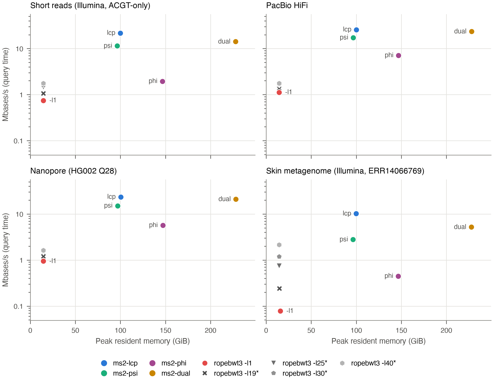

Matching statistics (MS) only: query speed against peak resident memory for ms2 layouts (ms2-lcp, ms2-psi, ms2-dual, ordinary queries) and ropebwt3 MS-only modes. Query sets: Short reads (Illumina, ACGT-only), 480,000 reads, 60.00 Mbases; PacBio HiFi, 2,869 reads, 59.99 Mbases; Nanopore (HG002 Q28), 2,706 reads, 59.93 Mbases; Skin metagenome (Illumina, ERR14066769), 438,969 reads, 60.00 Mbases; all reads are whole ACGT-only records. ropebwt3 -l1 (red) reports every MS value. An asterisk marks ropebwt3 modes that report only SMEMs of at least the given length (-l19 is the default), so they cannot find all MS values or all SMEMs. Reference: HPRC2 full (Human472, 472 haplotypes). Single thread, NUMA-bound (numactl CPU and memory binding to one node). Speed is query time only; index load time is excluded and reported separately (Load times table below). Each value is the median of two timed runs after one warmup run. Orbit commit 2885ee8. Peak resident memory is the process peak RSS.

Load times

| Read set | Series | Median load (s) | Median query (s) |
| --- | --- | ---: | ---: |
| Short reads (Illumina, ACGT-only) | ms2-lcp | 41.90 | 2.76 |
| Short reads (Illumina, ACGT-only) | ms2-psi | 45.21 | 5.26 |
| Short reads (Illumina, ACGT-only) | ms2-phi | 60.97 | 30.75 |
| Short reads (Illumina, ACGT-only) | ms2-dual | 94.92 | 4.22 |
| Short reads (Illumina, ACGT-only) | ropebwt3 -l1 | 4.27 | 80.34 |
| Short reads (Illumina, ACGT-only) | ropebwt3 -l19* | 4.21 | 56.43 |
| Short reads (Illumina, ACGT-only) | ropebwt3 -l25* | 4.22 | 41.38 |
| Short reads (Illumina, ACGT-only) | ropebwt3 -l30* | 4.16 | 37.64 |
| Short reads (Illumina, ACGT-only) | ropebwt3 -l40* | 4.18 | 34.09 |
| PacBio HiFi | ms2-lcp | 41.33 | 2.33 |
| PacBio HiFi | ms2-psi | 45.20 | 3.48 |
| PacBio HiFi | ms2-phi | 60.57 | 8.45 |
| PacBio HiFi | ms2-dual | 92.49 | 2.54 |
| PacBio HiFi | ropebwt3 -l1 | 4.26 | 53.39 |
| PacBio HiFi | ropebwt3 -l19* | 4.26 | 44.01 |
| PacBio HiFi | ropebwt3 -l25* | 4.27 | 37.21 |
| PacBio HiFi | ropebwt3 -l30* | 4.16 | 35.83 |
| PacBio HiFi | ropebwt3 -l40* | 4.27 | 34.23 |
| Nanopore (HG002 Q28) | ms2-lcp | 41.84 | 2.55 |
| Nanopore (HG002 Q28) | ms2-psi | 45.18 | 3.98 |
| Nanopore (HG002 Q28) | ms2-phi | 60.79 | 10.55 |
| Nanopore (HG002 Q28) | ms2-dual | 92.96 | 2.84 |
| Nanopore (HG002 Q28) | ropebwt3 -l1 | 4.20 | 63.43 |
| Nanopore (HG002 Q28) | ropebwt3 -l19* | 4.20 | 49.45 |
| Nanopore (HG002 Q28) | ropebwt3 -l25* | 4.20 | 40.46 |
| Nanopore (HG002 Q28) | ropebwt3 -l30* | 4.18 | 38.69 |
| Nanopore (HG002 Q28) | ropebwt3 -l40* | 4.25 | 36.65 |
| Skin metagenome (Illumina, ERR14066769) | ms2-lcp | 43.24 | 5.91 |
| Skin metagenome (Illumina, ERR14066769) | ms2-psi | 45.72 | 21.53 |
| Skin metagenome (Illumina, ERR14066769) | ms2-phi | 60.62 | 134.17 |
| Skin metagenome (Illumina, ERR14066769) | ms2-dual | 95.54 | 11.49 |
| Skin metagenome (Illumina, ERR14066769) | ropebwt3 -l1 | 4.23 | 768.63 |
| Skin metagenome (Illumina, ERR14066769) | ropebwt3 -l19* | 4.16 | 247.70 |
| Skin metagenome (Illumina, ERR14066769) | ropebwt3 -l25* | 4.15 | 80.37 |
| Skin metagenome (Illumina, ERR14066769) | ropebwt3 -l30* | 4.16 | 50.52 |
| Skin metagenome (Illumina, ERR14066769) | ropebwt3 -l40* | 4.15 | 28.07 |

## Fig MS+Oracle (`fig-ms-oracle`)

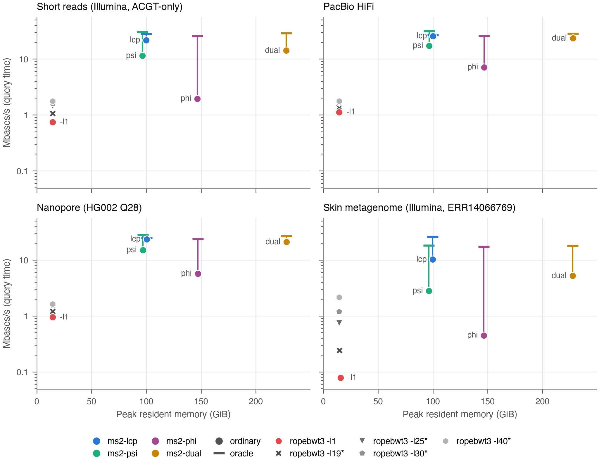

As Fig MS, adding oracle replay for each ms2 layout. A vertical line in the layout's color rises from the ordinary point (circle) to a horizontal tick for the oracle. Oracle replay runs a recorded query and loads only LF, so it is drawn at the peak memory of the same layout's ordinary run. Query sets: Short reads (Illumina, ACGT-only), 480,000 reads, 60.00 Mbases; PacBio HiFi, 2,869 reads, 59.99 Mbases; Nanopore (HG002 Q28), 2,706 reads, 59.93 Mbases; Skin metagenome (Illumina, ERR14066769), 438,969 reads, 60.00 Mbases. An asterisk marks ropebwt3 modes that report only SMEMs of at least the given length (-l19 is the default), so they cannot find all MS values or all SMEMs. Reference: HPRC2 full (Human472, 472 haplotypes). Single thread, NUMA-bound (numactl CPU and memory binding to one node). Speed is query time only; index load time is excluded and reported separately (Load times table below). Each value is the median of two timed runs after one warmup run. Orbit commit 2885ee8. Peak resident memory is the process peak RSS.

Load times

| Read set | Series | Median load (s) | Median query (s) |
| --- | --- | ---: | ---: |
| Short reads (Illumina, ACGT-only) | ms2-lcp | 41.90 | 2.76 |
| Short reads (Illumina, ACGT-only) | ms2-lcp oracle | 42.34 | 2.12 |
| Short reads (Illumina, ACGT-only) | ms2-psi | 45.21 | 5.26 |
| Short reads (Illumina, ACGT-only) | ms2-psi oracle | 45.32 | 1.95 |
| Short reads (Illumina, ACGT-only) | ms2-phi | 60.97 | 30.75 |
| Short reads (Illumina, ACGT-only) | ms2-phi oracle | 40.55 | 2.35 |
| Short reads (Illumina, ACGT-only) | ms2-dual | 94.92 | 4.22 |
| Short reads (Illumina, ACGT-only) | ms2-dual oracle | 75.03 | 2.08 |
| Short reads (Illumina, ACGT-only) | ropebwt3 -l1 | 4.27 | 80.34 |
| Short reads (Illumina, ACGT-only) | ropebwt3 -l19* | 4.21 | 56.43 |
| Short reads (Illumina, ACGT-only) | ropebwt3 -l25* | 4.22 | 41.38 |
| Short reads (Illumina, ACGT-only) | ropebwt3 -l30* | 4.16 | 37.64 |
| Short reads (Illumina, ACGT-only) | ropebwt3 -l40* | 4.18 | 34.09 |
| PacBio HiFi | ms2-lcp | 41.33 | 2.33 |
| PacBio HiFi | ms2-lcp oracle | 41.35 | 2.24 |
| PacBio HiFi | ms2-psi | 45.20 | 3.48 |
| PacBio HiFi | ms2-psi oracle | 44.85 | 1.92 |
| PacBio HiFi | ms2-phi | 60.57 | 8.45 |
| PacBio HiFi | ms2-phi oracle | 40.47 | 2.35 |
| PacBio HiFi | ms2-dual | 92.49 | 2.54 |
| PacBio HiFi | ms2-dual oracle | 75.09 | 2.09 |
| PacBio HiFi | ropebwt3 -l1 | 4.26 | 53.39 |
| PacBio HiFi | ropebwt3 -l19* | 4.26 | 44.01 |
| PacBio HiFi | ropebwt3 -l25* | 4.27 | 37.21 |
| PacBio HiFi | ropebwt3 -l30* | 4.16 | 35.83 |
| PacBio HiFi | ropebwt3 -l40* | 4.27 | 34.23 |
| Nanopore (HG002 Q28) | ms2-lcp | 41.84 | 2.55 |
| Nanopore (HG002 Q28) | ms2-lcp oracle | 41.57 | 2.42 |
| Nanopore (HG002 Q28) | ms2-psi | 45.18 | 3.98 |
| Nanopore (HG002 Q28) | ms2-psi oracle | 45.59 | 2.14 |
| Nanopore (HG002 Q28) | ms2-phi | 60.79 | 10.55 |
| Nanopore (HG002 Q28) | ms2-phi oracle | 40.16 | 2.52 |
| Nanopore (HG002 Q28) | ms2-dual | 92.96 | 2.84 |
| Nanopore (HG002 Q28) | ms2-dual oracle | 73.45 | 2.24 |
| Nanopore (HG002 Q28) | ropebwt3 -l1 | 4.20 | 63.43 |
| Nanopore (HG002 Q28) | ropebwt3 -l19* | 4.20 | 49.45 |
| Nanopore (HG002 Q28) | ropebwt3 -l25* | 4.20 | 40.46 |
| Nanopore (HG002 Q28) | ropebwt3 -l30* | 4.18 | 38.69 |
| Nanopore (HG002 Q28) | ropebwt3 -l40* | 4.25 | 36.65 |
| Skin metagenome (Illumina, ERR14066769) | ms2-lcp | 43.24 | 5.91 |
| Skin metagenome (Illumina, ERR14066769) | ms2-lcp oracle | 42.04 | 2.30 |
| Skin metagenome (Illumina, ERR14066769) | ms2-psi | 45.72 | 21.53 |
| Skin metagenome (Illumina, ERR14066769) | ms2-psi oracle | 46.64 | 3.30 |
| Skin metagenome (Illumina, ERR14066769) | ms2-phi | 60.62 | 134.17 |
| Skin metagenome (Illumina, ERR14066769) | ms2-phi oracle | 40.14 | 3.44 |
| Skin metagenome (Illumina, ERR14066769) | ms2-dual | 95.54 | 11.49 |
| Skin metagenome (Illumina, ERR14066769) | ms2-dual oracle | 75.83 | 3.33 |
| Skin metagenome (Illumina, ERR14066769) | ropebwt3 -l1 | 4.23 | 768.63 |
| Skin metagenome (Illumina, ERR14066769) | ropebwt3 -l19* | 4.16 | 247.70 |
| Skin metagenome (Illumina, ERR14066769) | ropebwt3 -l25* | 4.15 | 80.37 |
| Skin metagenome (Illumina, ERR14066769) | ropebwt3 -l30* | 4.16 | 50.52 |
| Skin metagenome (Illumina, ERR14066769) | ropebwt3 -l40* | 4.15 | 28.07 |

## Fig MS+ftab (`fig-ms-ftab`)

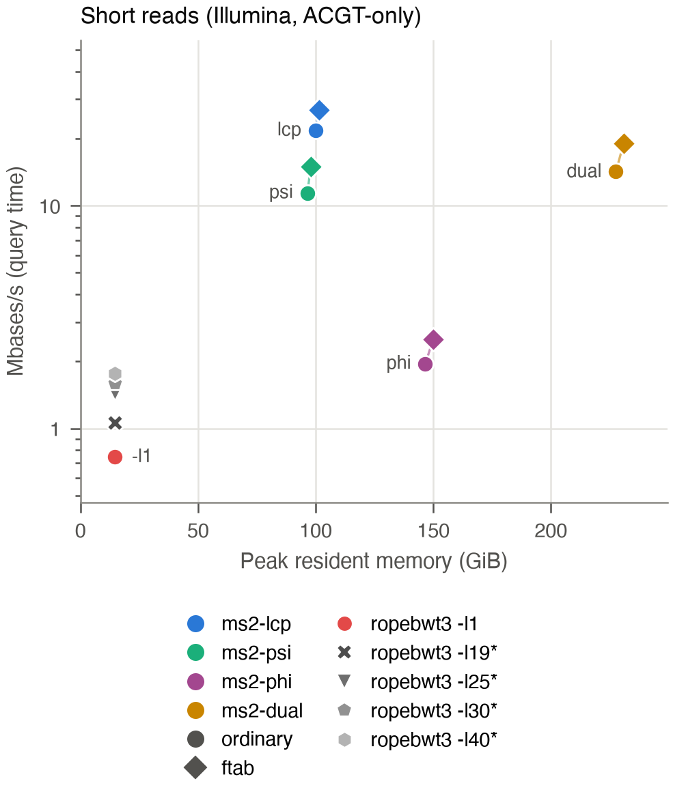

Short reads only: MS speed against peak memory for ms2 layouts without (circle) and with (diamond) an ftab (k-mer lookup table that skips the first steps of backward search), plus ropebwt3 MS-only modes. Lines join each layout with its ftab variant; the ftab point is at its own measured peak. Query set: Short reads (Illumina, ACGT-only), 480,000 reads, 60.00 Mbases. An asterisk marks ropebwt3 modes that report only SMEMs of at least the given length (-l19 is the default), so they cannot find all MS values or all SMEMs. Reference: HPRC2 full (Human472, 472 haplotypes). Single thread, NUMA-bound (numactl CPU and memory binding to one node). Speed is query time only; index load time is excluded and reported separately (Load times table below). Each value is the median of two timed runs after one warmup run. Orbit commit 2885ee8. Peak resident memory is the process peak RSS.

Load times

| Read set | Series | Median load (s) | Median query (s) |
| --- | --- | ---: | ---: |
| Short reads (Illumina, ACGT-only) | ms2-lcp | 41.90 | 2.76 |
| Short reads (Illumina, ACGT-only) | ms2-lcp+ftab | 43.27 | 2.23 |
| Short reads (Illumina, ACGT-only) | ms2-psi | 45.21 | 5.26 |
| Short reads (Illumina, ACGT-only) | ms2-psi+ftab | 45.62 | 4.01 |
| Short reads (Illumina, ACGT-only) | ms2-phi | 60.97 | 30.75 |
| Short reads (Illumina, ACGT-only) | ms2-phi+ftab | 62.07 | 23.88 |
| Short reads (Illumina, ACGT-only) | ms2-dual | 94.92 | 4.22 |
| Short reads (Illumina, ACGT-only) | ms2-dual+ftab | 95.20 | 3.15 |
| Short reads (Illumina, ACGT-only) | ropebwt3 -l1 | 4.27 | 80.34 |
| Short reads (Illumina, ACGT-only) | ropebwt3 -l19* | 4.21 | 56.43 |
| Short reads (Illumina, ACGT-only) | ropebwt3 -l25* | 4.22 | 41.38 |
| Short reads (Illumina, ACGT-only) | ropebwt3 -l30* | 4.16 | 37.64 |
| Short reads (Illumina, ACGT-only) | ropebwt3 -l40* | 4.18 | 34.09 |

## Fig MS22-10 (`fig-ms22-10`)

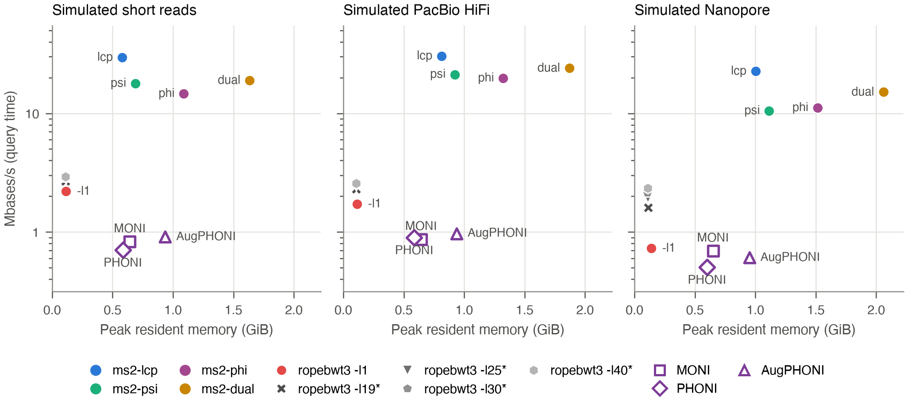

Matching statistics (MS) only on chr22-h10, simulated reads: query speed against peak resident memory for ms2 layouts (ms2-lcp, ms2-psi, ms2-dual, ordinary queries), ropebwt3 MS-only modes, and MONI, PHONI and AugPHONI. Reads are simulated from chr22 of the held-out haplotype NA19240 paternal (HPRC sample 200245_NA19240.pat; chr22 contigs placed by its RagTag scaffold, 51.09 Mbases of ACGT), which is absent from both the chr22-h10 and the chr22-h100 references (neither the sample nor its donor is in either panel). Each set targets 60 Mbases of whole ACGT-only reads. Simulated short reads: ART 2.5.8, HiSeq 2500 profile (-ss HS25), single-end 125 bp; 480,000 reads, 60.00 Mbases. Simulated PacBio HiFi: pbsim3 3.0.5 multi-pass subreads (QSHMM-RSII model, 10 passes) made into HiFi reads by ccs 6.4.0 (defaults: at least 3 passes, predicted accuracy at least 0.99), with read lengths drawn from the real PacBio HiFi set (median 20,177 bases); 2,864 reads, 59.99 Mbases. Simulated Nanopore: pbsim3 3.0.5 with its standard ONT model (ERRHMM-ONT-HQ) at mean accuracy 0.96, the model's ceiling (measured 95.98 percent), below the accuracy of real HG002 Q28 data, with read lengths drawn from the real Nanopore (HG002 Q28) set (N50 94,132 bases); 2,782 reads, 60.00 Mbases. Manifests: results/campaign-20261012/inputs/chr22_sim/ (short-60mb-v1, pacbio-60mb-v1, ont-60mb-v1, haplotype-NA19240-pat-chr22-v1). ropebwt3 -l1 (red) reports every MS value. An asterisk marks ropebwt3 modes that report only SMEMs of at least the given length (-l19 is the default), so they cannot find all MS values or all SMEMs. ropebwt3 runs with -K 1m. MONI, PHONI and AugPHONI (purple) are drawn hollow because their speed uses the one-read wall fallback: whole-process wall time minus the wall time of a one-read run, rather than the load/query split that ms2 and ropebwt3 report, so their speed includes any load work that the one-read subtraction does not cancel. Reference: chr22-h10 (chr22 of 10 HPRC haplotypes from 5 donors). Single thread, NUMA-bound (numactl CPU and memory binding to one node). Speed is query time only; index load time is excluded and reported separately (Load times table below). Each value is the median of two timed runs after one warmup run. Orbit commit 2885ee8. Peak resident memory is the process peak RSS.

Load times

| Read set | Series | Median load (s) | Median query (s) |
| --- | --- | ---: | ---: |
| Simulated short reads | ms2-lcp | 0.26 | 2.03 |
| Simulated short reads | ms2-psi | 0.34 | 3.36 |
| Simulated short reads | ms2-phi | 0.46 | 4.10 |
| Simulated short reads | ms2-dual | 0.69 | 3.16 |
| Simulated short reads | ropebwt3 -l1 | 0.03 | 27.25 |
| Simulated short reads | ropebwt3 -l19* | 0.03 | 22.35 |
| Simulated short reads | ropebwt3 -l25* | 0.03 | 21.26 |
| Simulated short reads | ropebwt3 -l30* | 0.03 | 20.95 |
| Simulated short reads | ropebwt3 -l40* | 0.03 | 20.54 |
| Simulated short reads | MONI | 0.24 | 72.42 |
| Simulated short reads | PHONI | 0.22 | 85.40 |
| Simulated short reads | AugPHONI | 0.34 | 66.01 |
| Simulated PacBio HiFi | ms2-lcp | 0.27 | 1.98 |
| Simulated PacBio HiFi | ms2-psi | 0.34 | 2.82 |
| Simulated PacBio HiFi | ms2-phi | 0.47 | 3.04 |
| Simulated PacBio HiFi | ms2-dual | 0.71 | 2.49 |
| Simulated PacBio HiFi | ropebwt3 -l1 | 0.03 | 34.79 |
| Simulated PacBio HiFi | ropebwt3 -l19* | 0.03 | 26.16 |
| Simulated PacBio HiFi | ropebwt3 -l25* | 0.03 | 24.43 |
| Simulated PacBio HiFi | ropebwt3 -l30* | 0.03 | 23.78 |
| Simulated PacBio HiFi | ropebwt3 -l40* | 0.03 | 23.25 |
| Simulated PacBio HiFi | MONI | 0.27 | 69.17 |
| Simulated PacBio HiFi | PHONI | 0.25 | 67.12 |
| Simulated PacBio HiFi | AugPHONI | 0.37 | 61.70 |
| Simulated Nanopore | ms2-lcp | 0.26 | 2.66 |
| Simulated Nanopore | ms2-psi | 0.34 | 5.72 |
| Simulated Nanopore | ms2-phi | 0.46 | 5.40 |
| Simulated Nanopore | ms2-dual | 0.69 | 3.97 |
| Simulated Nanopore | ropebwt3 -l1 | 0.03 | 82.21 |
| Simulated Nanopore | ropebwt3 -l19* | 0.03 | 37.21 |
| Simulated Nanopore | ropebwt3 -l25* | 0.03 | 30.55 |
| Simulated Nanopore | ropebwt3 -l30* | 0.03 | 27.90 |
| Simulated Nanopore | ropebwt3 -l40* | 0.03 | 25.58 |
| Simulated Nanopore | MONI | 0.28 | 86.64 |
| Simulated Nanopore | PHONI | 0.26 | 119.31 |
| Simulated Nanopore | AugPHONI | 0.37 | 98.79 |

## Fig MS22-100 (`fig-ms22-100`)

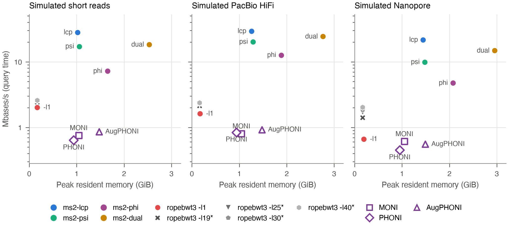

Matching statistics (MS) only on chr22-h100, simulated reads: query speed against peak resident memory for ms2 layouts (ms2-lcp, ms2-psi, ms2-dual, ordinary queries), ropebwt3 MS-only modes, and MONI, PHONI and AugPHONI. Reads are simulated from chr22 of the held-out haplotype NA19240 paternal (HPRC sample 200245_NA19240.pat; chr22 contigs placed by its RagTag scaffold, 51.09 Mbases of ACGT), which is absent from both the chr22-h10 and the chr22-h100 references (neither the sample nor its donor is in either panel). Each set targets 60 Mbases of whole ACGT-only reads. Simulated short reads: ART 2.5.8, HiSeq 2500 profile (-ss HS25), single-end 125 bp; 480,000 reads, 60.00 Mbases. Simulated PacBio HiFi: pbsim3 3.0.5 multi-pass subreads (QSHMM-RSII model, 10 passes) made into HiFi reads by ccs 6.4.0 (defaults: at least 3 passes, predicted accuracy at least 0.99), with read lengths drawn from the real PacBio HiFi set (median 20,177 bases); 2,864 reads, 59.99 Mbases. Simulated Nanopore: pbsim3 3.0.5 with its standard ONT model (ERRHMM-ONT-HQ) at mean accuracy 0.96, the model's ceiling (measured 95.98 percent), below the accuracy of real HG002 Q28 data, with read lengths drawn from the real Nanopore (HG002 Q28) set (N50 94,132 bases); 2,782 reads, 60.00 Mbases. Manifests: results/campaign-20261012/inputs/chr22_sim/ (short-60mb-v1, pacbio-60mb-v1, ont-60mb-v1, haplotype-NA19240-pat-chr22-v1). ropebwt3 -l1 (red) reports every MS value. An asterisk marks ropebwt3 modes that report only SMEMs of at least the given length (-l19 is the default), so they cannot find all MS values or all SMEMs. ropebwt3 runs with -K 1m. MONI, PHONI and AugPHONI (purple) are drawn hollow because their speed uses the one-read wall fallback: whole-process wall time minus the wall time of a one-read run, rather than the load/query split that ms2 and ropebwt3 report, so their speed includes any load work that the one-read subtraction does not cancel. Reference: chr22-h100 (chr22 of 100 HPRC haplotypes from 50 donors). Single thread, NUMA-bound (numactl CPU and memory binding to one node). Speed is query time only; index load time is excluded and reported separately (Load times table below). Each value is the median of two timed runs after one warmup run. Orbit commit 2885ee8. Peak resident memory is the process peak RSS.

Load times

| Read set | Series | Median load (s) | Median query (s) |
| --- | --- | ---: | ---: |
| Simulated short reads | ms2-lcp | 0.44 | 2.14 |
| Simulated short reads | ms2-psi | 0.52 | 3.50 |
| Simulated short reads | ms2-phi | 0.68 | 8.33 |
| Simulated short reads | ms2-dual | 1.05 | 3.27 |
| Simulated short reads | ropebwt3 -l1 | 0.05 | 29.73 |
| Simulated short reads | ropebwt3 -l19* | 0.05 | 24.65 |
| Simulated short reads | ropebwt3 -l25* | 0.05 | 24.06 |
| Simulated short reads | ropebwt3 -l30* | 0.05 | 23.43 |
| Simulated short reads | ropebwt3 -l40* | 0.05 | 23.09 |
| Simulated short reads | MONI | 0.37 | 79.20 |
| Simulated short reads | PHONI | 0.32 | 94.12 |
| Simulated short reads | AugPHONI | 0.49 | 69.61 |
| Simulated PacBio HiFi | ms2-lcp | 0.44 | 2.05 |
| Simulated PacBio HiFi | ms2-psi | 0.51 | 2.98 |
| Simulated PacBio HiFi | ms2-phi | 0.68 | 4.76 |
| Simulated PacBio HiFi | ms2-dual | 1.05 | 2.46 |
| Simulated PacBio HiFi | ropebwt3 -l1 | 0.05 | 37.03 |
| Simulated PacBio HiFi | ropebwt3 -l19* | 0.05 | 27.96 |
| Simulated PacBio HiFi | ropebwt3 -l25* | 0.04 | 26.44 |
| Simulated PacBio HiFi | ropebwt3 -l30* | 0.05 | 25.94 |
| Simulated PacBio HiFi | ropebwt3 -l40* | 0.05 | 25.29 |
| Simulated PacBio HiFi | MONI | 0.39 | 74.54 |
| Simulated PacBio HiFi | PHONI | 0.34 | 71.28 |
| Simulated PacBio HiFi | AugPHONI | 0.51 | 64.90 |
| Simulated Nanopore | ms2-lcp | 0.44 | 2.78 |
| Simulated Nanopore | ms2-psi | 0.51 | 6.07 |
| Simulated Nanopore | ms2-phi | 0.68 | 12.65 |
| Simulated Nanopore | ms2-dual | 1.05 | 4.04 |
| Simulated Nanopore | ropebwt3 -l1 | 0.05 | 90.26 |
| Simulated Nanopore | ropebwt3 -l19* | 0.04 | 42.45 |
| Simulated Nanopore | ropebwt3 -l25* | 0.04 | 35.26 |
| Simulated Nanopore | ropebwt3 -l30* | 0.05 | 32.11 |
| Simulated Nanopore | ropebwt3 -l40* | 0.05 | 29.40 |
| Simulated Nanopore | MONI | 0.40 | 97.85 |
| Simulated Nanopore | PHONI | 0.37 | 132.93 |
| Simulated Nanopore | AugPHONI | 0.54 | 108.00 |

## Fig L1 (`fig-l1`)

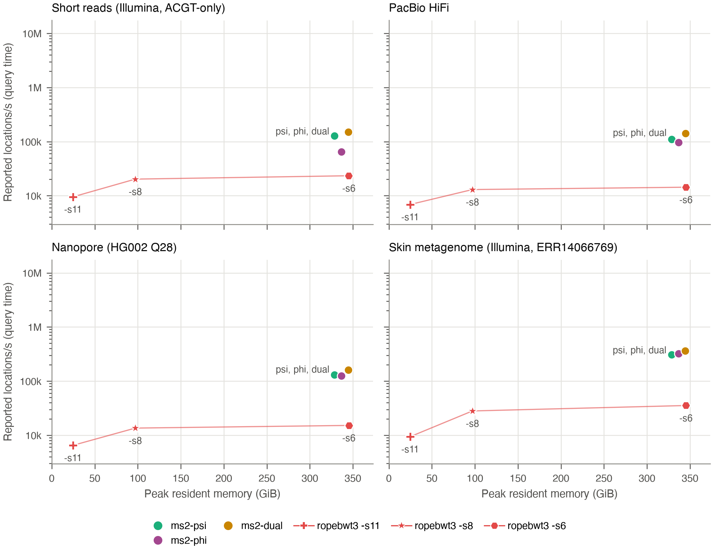

SMEM offset reporting (locate) with at most N = 1 reported positions per SMEM: reported locations per second of query time against peak memory. ms2-min has no locate support, so the ms2 SMEM reporting set is ms2-psi and ms2-dual (ordinary). Both locate from the same index file (the Dual index with sequence ids), so they share one peak memory. ropebwt3 runs -l1 -pN with sampled suffix arrays at shifts 11, 8 and 6 (-s11, -s8, -s6; denser sampling uses more memory), with -K 1m. Every output was checked: ms2 and ropebwt3 agree with zero differences at each cap. ms2-psi and ms2-dual are offset horizontally by 5 GiB to either side of their shared peak for visibility. Query sets (smaller than the MS sets): Short reads (Illumina, ACGT-only), 48,000 reads, 6.00 Mbases; PacBio HiFi, 953 reads, 19.99 Mbases; Nanopore (HG002 Q28), 494 reads, 9.95 Mbases; Skin metagenome (Illumina, ERR14066769), 3,698 reads, 500 kbases. Reference: HPRC2 full (Human472, 472 haplotypes). Single thread, NUMA-bound (numactl CPU and memory binding to one node). Speed is query time only; index load time is excluded and reported separately (Load times table below). Each value is the median of two timed runs after one warmup run. Orbit commit 2885ee8. Peak resident memory is the process peak RSS.

Load times

| Read set | Series | Median load (s) | Median query (s) |
| --- | --- | ---: | ---: |
| Short reads (Illumina, ACGT-only) | ms2-psi | 184.65 | 1.25 |
| Short reads (Illumina, ACGT-only) | ms2-phi | 188.32 | 2.45 |
| Short reads (Illumina, ACGT-only) | ms2-dual | 188.36 | 1.04 |
| Short reads (Illumina, ACGT-only) | ropebwt3 -s11 | 6.96 | 16.59 |
| Short reads (Illumina, ACGT-only) | ropebwt3 -s8 | 27.19 | 7.81 |
| Short reads (Illumina, ACGT-only) | ropebwt3 -s6 | 99.53 | 6.76 |
| PacBio HiFi | ms2-psi | 181.88 | 2.37 |
| PacBio HiFi | ms2-phi | 186.82 | 2.72 |
| PacBio HiFi | ms2-dual | 188.90 | 1.85 |
| PacBio HiFi | ropebwt3 -s11 | 7.22 | 38.15 |
| PacBio HiFi | ropebwt3 -s8 | 27.99 | 20.20 |
| PacBio HiFi | ropebwt3 -s6 | 96.68 | 18.28 |
| Nanopore (HG002 Q28) | ms2-psi | 181.29 | 1.43 |
| Nanopore (HG002 Q28) | ms2-phi | 188.81 | 1.50 |
| Nanopore (HG002 Q28) | ms2-dual | 192.23 | 1.16 |
| Nanopore (HG002 Q28) | ropebwt3 -s11 | 7.17 | 28.73 |
| Nanopore (HG002 Q28) | ropebwt3 -s8 | 27.16 | 13.79 |
| Nanopore (HG002 Q28) | ropebwt3 -s6 | 99.38 | 12.32 |
| Skin metagenome (Illumina, ERR14066769) | ms2-psi | 185.06 | 0.82 |
| Skin metagenome (Illumina, ERR14066769) | ms2-phi | 187.57 | 0.79 |
| Skin metagenome (Illumina, ERR14066769) | ms2-dual | 188.47 | 0.70 |
| Skin metagenome (Illumina, ERR14066769) | ropebwt3 -s11 | 7.10 | 27.08 |
| Skin metagenome (Illumina, ERR14066769) | ropebwt3 -s8 | 27.59 | 9.06 |
| Skin metagenome (Illumina, ERR14066769) | ropebwt3 -s6 | 97.82 | 7.19 |

## Fig L10 (`fig-l10`)

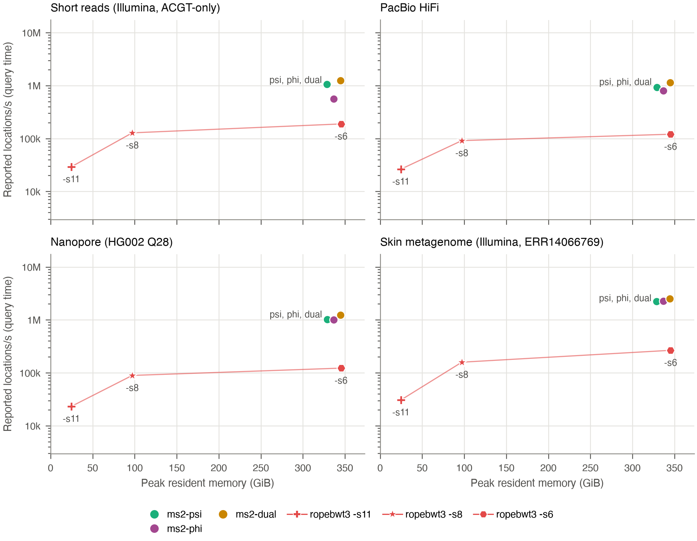

SMEM offset reporting (locate) with at most N = 10 reported positions per SMEM: reported locations per second of query time against peak memory. ms2-min has no locate support, so the ms2 SMEM reporting set is ms2-psi and ms2-dual (ordinary). Both locate from the same index file (the Dual index with sequence ids), so they share one peak memory. ropebwt3 runs -l1 -pN with sampled suffix arrays at shifts 11, 8 and 6 (-s11, -s8, -s6; denser sampling uses more memory), with -K 1m. Every output was checked: ms2 and ropebwt3 agree with zero differences at each cap. ms2-psi and ms2-dual are offset horizontally by 5 GiB to either side of their shared peak for visibility. Query sets (smaller than the MS sets): Short reads (Illumina, ACGT-only), 48,000 reads, 6.00 Mbases; PacBio HiFi, 953 reads, 19.99 Mbases; Nanopore (HG002 Q28), 494 reads, 9.95 Mbases; Skin metagenome (Illumina, ERR14066769), 3,698 reads, 500 kbases. Reference: HPRC2 full (Human472, 472 haplotypes). Single thread, NUMA-bound (numactl CPU and memory binding to one node). Speed is query time only; index load time is excluded and reported separately (Load times table below). Each value is the median of two timed runs after one warmup run. Orbit commit 2885ee8. Peak resident memory is the process peak RSS.

Load times

| Read set | Series | Median load (s) | Median query (s) |
| --- | --- | ---: | ---: |
| Short reads (Illumina, ACGT-only) | ms2-psi | 187.33 | 1.37 |
| Short reads (Illumina, ACGT-only) | ms2-phi | 188.32 | 2.57 |
| Short reads (Illumina, ACGT-only) | ms2-dual | 186.13 | 1.15 |
| Short reads (Illumina, ACGT-only) | ropebwt3 -s11 | 6.96 | 49.30 |
| Short reads (Illumina, ACGT-only) | ropebwt3 -s8 | 27.64 | 11.27 |
| Short reads (Illumina, ACGT-only) | ropebwt3 -s6 | 98.15 | 7.65 |
| PacBio HiFi | ms2-psi | 181.67 | 2.58 |
| PacBio HiFi | ms2-phi | 187.93 | 2.98 |
| PacBio HiFi | ms2-dual | 186.41 | 2.07 |
| PacBio HiFi | ropebwt3 -s11 | 7.18 | 89.88 |
| PacBio HiFi | ropebwt3 -s8 | 27.15 | 25.96 |
| PacBio HiFi | ropebwt3 -s6 | 98.20 | 19.67 |
| Nanopore (HG002 Q28) | ms2-psi | 184.74 | 1.61 |
| Nanopore (HG002 Q28) | ms2-phi | 184.40 | 1.64 |
| Nanopore (HG002 Q28) | ms2-dual | 192.27 | 1.33 |
| Nanopore (HG002 Q28) | ropebwt3 -s11 | 7.31 | 71.09 |
| Nanopore (HG002 Q28) | ropebwt3 -s8 | 27.07 | 18.50 |
| Nanopore (HG002 Q28) | ropebwt3 -s6 | 99.33 | 13.47 |
| Skin metagenome (Illumina, ERR14066769) | ms2-psi | 181.62 | 1.03 |
| Skin metagenome (Illumina, ERR14066769) | ms2-phi | 189.38 | 1.02 |
| Skin metagenome (Illumina, ERR14066769) | ms2-dual | 185.35 | 0.91 |
| Skin metagenome (Illumina, ERR14066769) | ropebwt3 -s11 | 7.11 | 74.89 |
| Skin metagenome (Illumina, ERR14066769) | ropebwt3 -s8 | 27.28 | 14.49 |
| Skin metagenome (Illumina, ERR14066769) | ropebwt3 -s6 | 98.92 | 8.64 |

## Fig L100 (`fig-l100`)

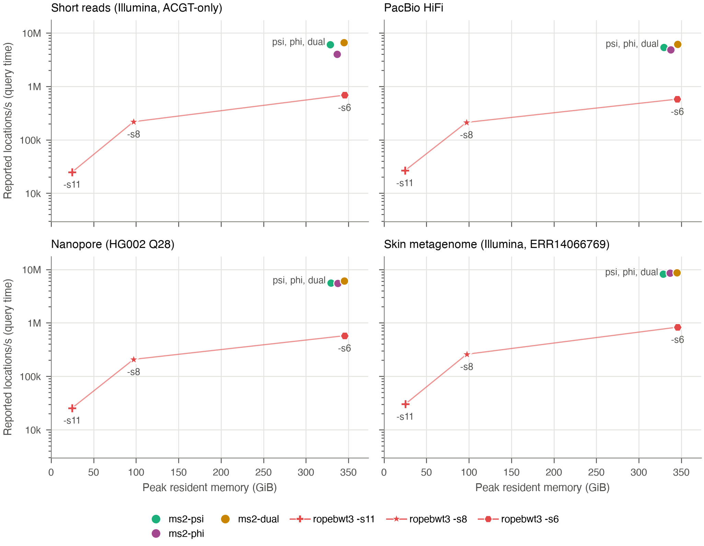

SMEM offset reporting (locate) with at most N = 100 reported positions per SMEM: reported locations per second of query time against peak memory. ms2-min has no locate support, so the ms2 SMEM reporting set is ms2-psi and ms2-dual (ordinary). Both locate from the same index file (the Dual index with sequence ids), so they share one peak memory. ropebwt3 runs -l1 -pN with sampled suffix arrays at shifts 11, 8 and 6 (-s11, -s8, -s6; denser sampling uses more memory), with -K 1m. Every output was checked: ms2 and ropebwt3 agree with zero differences at each cap. ms2-psi and ms2-dual are offset horizontally by 5 GiB to either side of their shared peak for visibility. Query sets (smaller than the MS sets): Short reads (Illumina, ACGT-only), 48,000 reads, 6.00 Mbases; PacBio HiFi, 953 reads, 19.99 Mbases; Nanopore (HG002 Q28), 494 reads, 9.95 Mbases; Skin metagenome (Illumina, ERR14066769), 3,698 reads, 500 kbases. Reference: HPRC2 full (Human472, 472 haplotypes). Single thread, NUMA-bound (numactl CPU and memory binding to one node). Speed is query time only; index load time is excluded and reported separately (Load times table below). Each value is the median of two timed runs after one warmup run. Orbit commit 2885ee8. Peak resident memory is the process peak RSS.

Load times

| Read set | Series | Median load (s) | Median query (s) |
| --- | --- | ---: | ---: |
| Short reads (Illumina, ACGT-only) | ms2-psi | 186.77 | 2.26 |
| Short reads (Illumina, ACGT-only) | ms2-phi | 186.45 | 3.41 |
| Short reads (Illumina, ACGT-only) | ms2-dual | 188.69 | 2.04 |
| Short reads (Illumina, ACGT-only) | ropebwt3 -s11 | 7.11 | 546.57 |
| Short reads (Illumina, ACGT-only) | ropebwt3 -s8 | 27.64 | 62.37 |
| Short reads (Illumina, ACGT-only) | ropebwt3 -s6 | 99.29 | 19.86 |
| PacBio HiFi | ms2-psi | 181.54 | 4.17 |
| PacBio HiFi | ms2-phi | 190.46 | 4.59 |
| PacBio HiFi | ms2-dual | 183.64 | 3.63 |
| PacBio HiFi | ropebwt3 -s11 | 7.22 | 840.22 |
| PacBio HiFi | ropebwt3 -s8 | 28.00 | 105.50 |
| PacBio HiFi | ropebwt3 -s6 | 98.28 | 38.69 |
| Nanopore (HG002 Q28) | ms2-psi | 183.77 | 2.76 |
| Nanopore (HG002 Q28) | ms2-phi | 186.32 | 2.80 |
| Nanopore (HG002 Q28) | ms2-dual | 192.08 | 2.51 |
| Nanopore (HG002 Q28) | ropebwt3 -s11 | 7.17 | 603.48 |
| Nanopore (HG002 Q28) | ropebwt3 -s8 | 27.53 | 74.15 |
| Nanopore (HG002 Q28) | ropebwt3 -s6 | 99.39 | 26.78 |
| Skin metagenome (Illumina, ERR14066769) | ms2-psi | 187.31 | 2.64 |
| Skin metagenome (Illumina, ERR14066769) | ms2-phi | 186.73 | 2.55 |
| Skin metagenome (Illumina, ERR14066769) | ms2-dual | 189.62 | 2.50 |
| Skin metagenome (Illumina, ERR14066769) | ropebwt3 -s11 | 7.12 | 724.08 |
| Skin metagenome (Illumina, ERR14066769) | ropebwt3 -s8 | 27.59 | 84.35 |
| Skin metagenome (Illumina, ERR14066769) | ropebwt3 -s6 | 98.59 | 26.22 |

## Fig LFtab (`fig-lftab`)

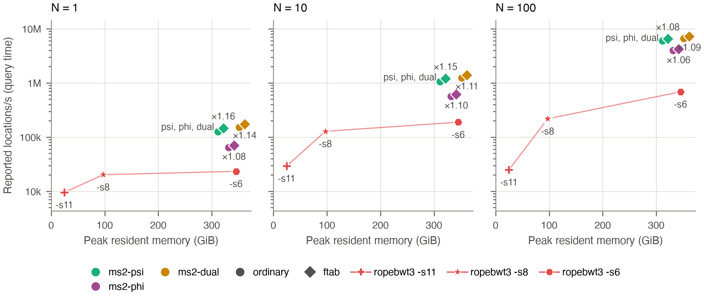

Short reads only, SMEM offset reporting at N = 1, 10 and 100: ms2-psi and ms2-dual without (circle) and with (diamond) ftab, plus ropebwt3 -s11, -s8 and -s6. Each ftab point is labeled with its speed ratio over the same layout without ftab. The four ms2 points are spread horizontally for visibility (left to right: psi, psi+ftab, dual, dual+ftab); measured peaks are about 293 GiB without ftab and 296 GiB with it. ms2-min has no locate support, so the ms2 SMEM reporting set is ms2-psi and ms2-dual (ordinary). Both locate from the same index file (the Dual index with sequence ids), so they share one peak memory. ropebwt3 runs -l1 -pN with sampled suffix arrays at shifts 11, 8 and 6 (-s11, -s8, -s6; denser sampling uses more memory), with -K 1m. Every output was checked: ms2 and ropebwt3 agree with zero differences at each cap. Query set: Short reads (Illumina, ACGT-only), 48,000 reads, 6.00 Mbases. Reference: HPRC2 full (Human472, 472 haplotypes). Single thread, NUMA-bound (numactl CPU and memory binding to one node). Speed is query time only; index load time is excluded and reported separately (Load times table below). Each value is the median of two timed runs after one warmup run. Orbit commit 2885ee8. Peak resident memory is the process peak RSS.

Load times

| Read set | Series | Median load (s) | Median query (s) |
| --- | --- | ---: | ---: |
| Short reads (Illumina, ACGT-only) | ms2-psi | 184.65 | 1.25 |
| Short reads (Illumina, ACGT-only) | ms2-psi+ftab | 181.85 | 1.08 |
| Short reads (Illumina, ACGT-only) | ms2-phi | 188.32 | 2.45 |
| Short reads (Illumina, ACGT-only) | ms2-phi+ftab | 191.99 | 2.26 |
| Short reads (Illumina, ACGT-only) | ms2-dual | 188.36 | 1.04 |
| Short reads (Illumina, ACGT-only) | ms2-dual+ftab | 186.64 | 0.92 |
| Short reads (Illumina, ACGT-only) | ropebwt3 -s11 | 6.96 | 16.59 |
| Short reads (Illumina, ACGT-only) | ropebwt3 -s8 | 27.19 | 7.81 |
| Short reads (Illumina, ACGT-only) | ropebwt3 -s6 | 99.53 | 6.76 |

## Fig LOracle (`fig-loracle`)

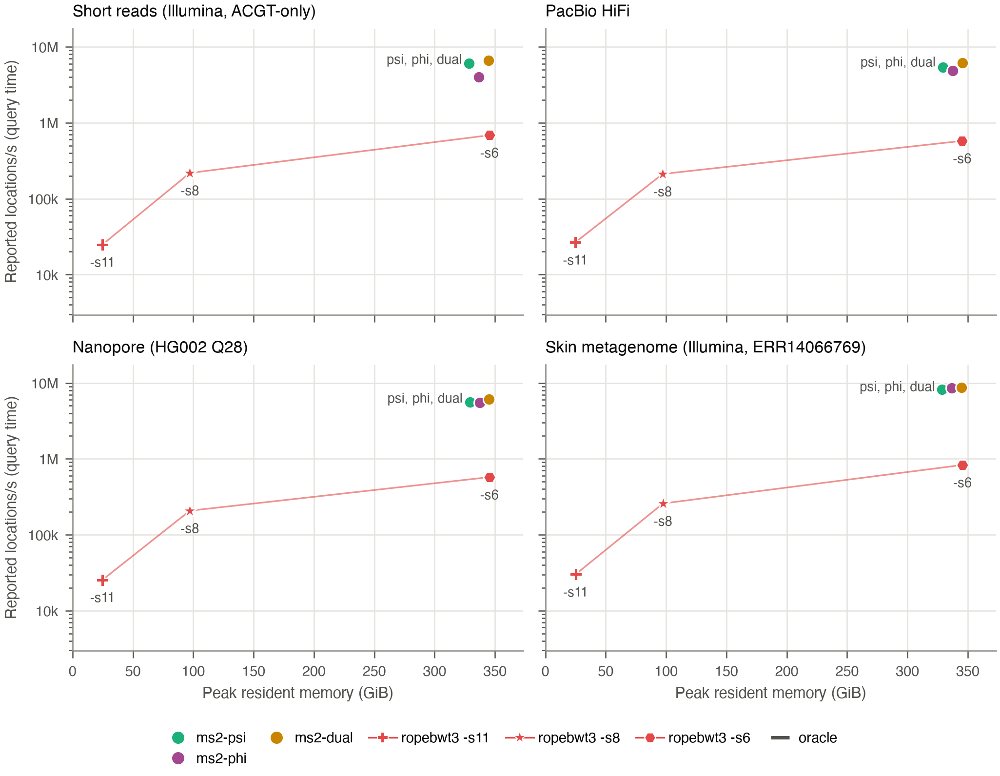

SMEM offset reporting (locate) with at most N = 100 reported positions per SMEM, as Fig L100, adding oracle replay for ms2-psi and ms2-dual. A vertical line in the layout's color rises from the ordinary point (circle) to a horizontal tick for the oracle, which replays a recorded run with every repositioning decision known in advance; its output is identical to the ordinary run's. The oracle replaces only the matching-statistics phase; counting, listing and formatting the reported locations run unchanged. ms2-min has no locate support, so the ms2 SMEM reporting set is ms2-psi and ms2-dual (ordinary). Both locate from the same index file (the Dual index with sequence ids), so they share one peak memory. ropebwt3 runs -l1 -pN with sampled suffix arrays at shifts 11, 8 and 6 (-s11, -s8, -s6; denser sampling uses more memory), with -K 1m. Every output was checked: ms2 and ropebwt3 agree with zero differences at each cap. ms2-psi and ms2-dual are offset horizontally by 5 GiB to either side of their shared peak for visibility. Oracle over ordinary locations per second: . Query sets (smaller than the MS sets): Short reads (Illumina, ACGT-only), 48,000 reads, 6.00 Mbases; PacBio HiFi, 953 reads, 19.99 Mbases; Nanopore (HG002 Q28), 494 reads, 9.95 Mbases; Skin metagenome (Illumina, ERR14066769), 3,698 reads, 500 kbases. Reference: HPRC2 full (Human472, 472 haplotypes). Single thread, NUMA-bound (numactl CPU and memory binding to one node). Speed is query time only; index load time is excluded and reported separately (Load times table below). Each value is the median of two timed runs after one warmup run. Orbit commit 2885ee8. Peak resident memory is the process peak RSS.

Load times

| Read set | Series | Median load (s) | Median query (s) |
| --- | --- | ---: | ---: |
| Short reads (Illumina, ACGT-only) | ms2-psi | 186.77 | 2.26 |
| Short reads (Illumina, ACGT-only) | ms2-phi | 186.45 | 3.41 |
| Short reads (Illumina, ACGT-only) | ms2-dual | 188.69 | 2.04 |
| Short reads (Illumina, ACGT-only) | ropebwt3 -s11 | 7.11 | 546.57 |
| Short reads (Illumina, ACGT-only) | ropebwt3 -s8 | 27.64 | 62.37 |
| Short reads (Illumina, ACGT-only) | ropebwt3 -s6 | 99.29 | 19.86 |
| PacBio HiFi | ms2-psi | 181.54 | 4.17 |
| PacBio HiFi | ms2-phi | 190.46 | 4.59 |
| PacBio HiFi | ms2-dual | 183.64 | 3.63 |
| PacBio HiFi | ropebwt3 -s11 | 7.22 | 840.22 |
| PacBio HiFi | ropebwt3 -s8 | 28.00 | 105.50 |
| PacBio HiFi | ropebwt3 -s6 | 98.28 | 38.69 |
| Nanopore (HG002 Q28) | ms2-psi | 183.77 | 2.76 |
| Nanopore (HG002 Q28) | ms2-phi | 186.32 | 2.80 |
| Nanopore (HG002 Q28) | ms2-dual | 192.08 | 2.51 |
| Nanopore (HG002 Q28) | ropebwt3 -s11 | 7.17 | 603.48 |
| Nanopore (HG002 Q28) | ropebwt3 -s8 | 27.53 | 74.15 |
| Nanopore (HG002 Q28) | ropebwt3 -s6 | 99.39 | 26.78 |
| Skin metagenome (Illumina, ERR14066769) | ms2-psi | 187.31 | 2.64 |
| Skin metagenome (Illumina, ERR14066769) | ms2-phi | 186.73 | 2.55 |
| Skin metagenome (Illumina, ERR14066769) | ms2-dual | 189.62 | 2.50 |
| Skin metagenome (Illumina, ERR14066769) | ropebwt3 -s11 | 7.12 | 724.08 |
| Skin metagenome (Illumina, ERR14066769) | ropebwt3 -s8 | 27.59 | 84.35 |
| Skin metagenome (Illumina, ERR14066769) | ropebwt3 -s6 | 98.59 | 26.22 |

## Fig LOracle1 (`fig-loracle1`)

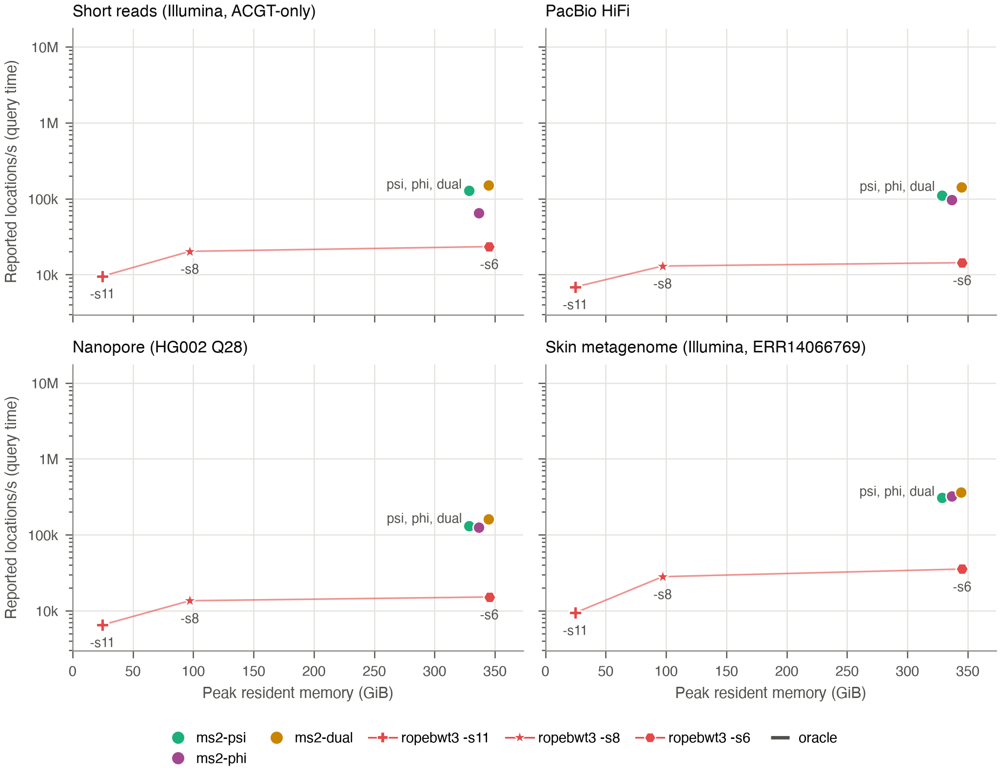

SMEM offset reporting (locate) with at most N = 1 reported positions per SMEM, as Fig L1, adding oracle replay for ms2-psi and ms2-dual. A vertical line in the layout's color rises from the ordinary point (circle) to a horizontal tick for the oracle, which replays a recorded run with every repositioning decision known in advance; its output is identical to the ordinary run's. The oracle replaces only the matching-statistics phase; counting, listing and formatting the reported locations run unchanged. ms2-min has no locate support, so the ms2 SMEM reporting set is ms2-psi and ms2-dual (ordinary). Both locate from the same index file (the Dual index with sequence ids), so they share one peak memory. ropebwt3 runs -l1 -pN with sampled suffix arrays at shifts 11, 8 and 6 (-s11, -s8, -s6; denser sampling uses more memory), with -K 1m. Every output was checked: ms2 and ropebwt3 agree with zero differences at each cap. ms2-psi and ms2-dual are offset horizontally by 5 GiB to either side of their shared peak for visibility. Oracle over ordinary locations per second: . Query sets (smaller than the MS sets): Short reads (Illumina, ACGT-only), 48,000 reads, 6.00 Mbases; PacBio HiFi, 953 reads, 19.99 Mbases; Nanopore (HG002 Q28), 494 reads, 9.95 Mbases; Skin metagenome (Illumina, ERR14066769), 3,698 reads, 500 kbases. Reference: HPRC2 full (Human472, 472 haplotypes). Single thread, NUMA-bound (numactl CPU and memory binding to one node). Speed is query time only; index load time is excluded and reported separately (Load times table below). Each value is the median of two timed runs after one warmup run. Orbit commit 2885ee8. Peak resident memory is the process peak RSS.

Load times

| Read set | Series | Median load (s) | Median query (s) |
| --- | --- | ---: | ---: |
| Short reads (Illumina, ACGT-only) | ms2-psi | 184.65 | 1.25 |
| Short reads (Illumina, ACGT-only) | ms2-phi | 188.32 | 2.45 |
| Short reads (Illumina, ACGT-only) | ms2-dual | 188.36 | 1.04 |
| Short reads (Illumina, ACGT-only) | ropebwt3 -s11 | 6.96 | 16.59 |
| Short reads (Illumina, ACGT-only) | ropebwt3 -s8 | 27.19 | 7.81 |
| Short reads (Illumina, ACGT-only) | ropebwt3 -s6 | 99.53 | 6.76 |
| PacBio HiFi | ms2-psi | 181.88 | 2.37 |
| PacBio HiFi | ms2-phi | 186.82 | 2.72 |
| PacBio HiFi | ms2-dual | 188.90 | 1.85 |
| PacBio HiFi | ropebwt3 -s11 | 7.22 | 38.15 |
| PacBio HiFi | ropebwt3 -s8 | 27.99 | 20.20 |
| PacBio HiFi | ropebwt3 -s6 | 96.68 | 18.28 |
| Nanopore (HG002 Q28) | ms2-psi | 181.29 | 1.43 |
| Nanopore (HG002 Q28) | ms2-phi | 188.81 | 1.50 |
| Nanopore (HG002 Q28) | ms2-dual | 192.23 | 1.16 |
| Nanopore (HG002 Q28) | ropebwt3 -s11 | 7.17 | 28.73 |
| Nanopore (HG002 Q28) | ropebwt3 -s8 | 27.16 | 13.79 |
| Nanopore (HG002 Q28) | ropebwt3 -s6 | 99.38 | 12.32 |
| Skin metagenome (Illumina, ERR14066769) | ms2-psi | 185.06 | 0.82 |
| Skin metagenome (Illumina, ERR14066769) | ms2-phi | 187.57 | 0.79 |
| Skin metagenome (Illumina, ERR14066769) | ms2-dual | 188.47 | 0.70 |
| Skin metagenome (Illumina, ERR14066769) | ropebwt3 -s11 | 7.10 | 27.08 |
| Skin metagenome (Illumina, ERR14066769) | ropebwt3 -s8 | 27.59 | 9.06 |
| Skin metagenome (Illumina, ERR14066769) | ropebwt3 -s6 | 97.82 | 7.19 |

## Fig Ops (`fig-ops`)

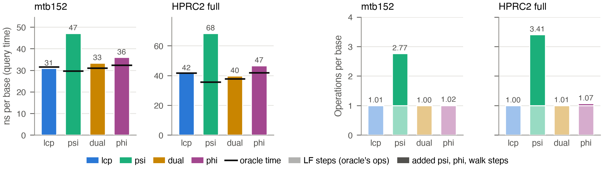

Time and operations per base for held-out genomes: ms2-lcp, ms2-psi, ms2-dual and ms2-phi (MS only, ordinary queries). Left pair: nanoseconds per query base, one bar per layout; a black tick across the bar marks the same layout's oracle replay. Right pair: operations per query base, stacked as LF steps (light segment) and the steps the layout adds on top (full color): psi steps for ms2-psi, phi steps for ms2-phi, both for ms2-dual, and walk rows (LCP rows scanned while repositioning) for ms2-lcp. The oracle takes exactly one LF step per base and nothing else, so the light segment is also the oracle's operation count; the full-color segment is the work the oracle avoids. Queries are genomes absent from the index. mtb152 is the TeraTools paper's 95 percent split queried with the 8 held-out genomes, each followed by its reverse complement (600 records, 59.1 Mbases). HPRC2 full is Human472 queried with APR008 haplotype 1 from the Arab Pangenome Reference (GenBank GCA_050494745.1, OpenHGL 210019_APR008.hap1), absent from Human472 (600 ACGT-only records, 0.06 Gbases). Records are split at every run of characters other than A, C, G and T. Repositions (mismatches that force the query to restart its match) are rare: 0.00065 per base on mtb152 and 0.00055 on HPRC2 full, which is why replay saves so little for ms2-lcp, whose only extra work is the walk at a reposition. References: mtb152 and HPRC2 full (Human472, 472 haplotypes). Single thread, interleave 32 (queries in flight at once), NUMA-bound (numactl CPU and memory binding to one node). Time is query time only; index load time is excluded and reported separately (Load times table below). Each time is the median of two timed runs after one warmup run. Operation counts come from a counting build of the same commit; Orbit commit 2885ee8.

Load times

| Read set | Series | Median load (s) | Median query (s) |
| --- | --- | ---: | ---: |
| mtb152, 8 held-out genomes and their reverse complements | ms2-lcp | 0.03 | 1.83 |
| mtb152, 8 held-out genomes and their reverse complements | ms2-lcp oracle | 0.04 | 1.87 |
| mtb152, 8 held-out genomes and their reverse complements | ms2-psi | 0.04 | 2.79 |
| mtb152, 8 held-out genomes and their reverse complements | ms2-psi oracle | 0.04 | 1.76 |
| mtb152, 8 held-out genomes and their reverse complements | ms2-dual | 0.09 | 1.97 |
| mtb152, 8 held-out genomes and their reverse complements | ms2-dual oracle | 0.07 | 1.83 |
| mtb152, 8 held-out genomes and their reverse complements | ms2-phi | 0.06 | 2.13 |
| mtb152, 8 held-out genomes and their reverse complements | ms2-phi oracle | 0.04 | 1.92 |
| mtb152, 8 held-out genomes and their reverse complements | ms2-lcp ops | 0.03 | 1.83 |
| mtb152, 8 held-out genomes and their reverse complements | ms2-psi ops | 0.04 | 2.79 |
| mtb152, 8 held-out genomes and their reverse complements | ms2-dual ops | 0.09 | 1.97 |
| mtb152, 8 held-out genomes and their reverse complements | ms2-phi ops | 0.06 | 2.13 |
| HPRC2 full, APR008 haplotype 1 | ms2-lcp | 42.55 | 2.48 |
| HPRC2 full, APR008 haplotype 1 | ms2-lcp oracle | 42.39 | 2.50 |
| HPRC2 full, APR008 haplotype 1 | ms2-psi | 45.23 | 4.09 |
| HPRC2 full, APR008 haplotype 1 | ms2-psi oracle | 45.27 | 2.13 |
| HPRC2 full, APR008 haplotype 1 | ms2-dual | 93.42 | 2.38 |
| HPRC2 full, APR008 haplotype 1 | ms2-dual oracle | 74.08 | 2.26 |
| HPRC2 full, APR008 haplotype 1 | ms2-phi | 58.90 | 2.79 |
| HPRC2 full, APR008 haplotype 1 | ms2-phi oracle | 39.19 | 2.51 |
| HPRC2 full, APR008 haplotype 1 | ms2-lcp ops | 42.55 | 2.48 |
| HPRC2 full, APR008 haplotype 1 | ms2-psi ops | 45.23 | 4.09 |
| HPRC2 full, APR008 haplotype 1 | ms2-dual ops | 93.42 | 2.38 |
| HPRC2 full, APR008 haplotype 1 | ms2-phi ops | 58.90 | 2.79 |

## Fig Ops2 (`fig-ops2`)

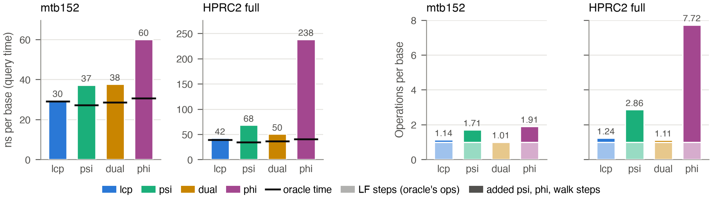

As Fig Ops, with simulated PacBio HiFi reads in place of whole held-out genomes. The reads are simulated as for chr22, from the held-out genomes: pbsim3 3.0.5 multi-pass subreads (QSHMM-RSII model, 10 passes) made into HiFi reads by ccs 6.4.0 (defaults: at least 3 passes, predicted accuracy at least 0.99), read lengths drawn from the real PacBio HiFi set, both strands, whole ACGT-only reads to about 60 Mbases. mtb152 reads come from the forward strand of the 8 held-out genomes and HPRC2 full reads from APR008 haplotype 1 (mtb152 2,855 reads, 60.0 Mbases; HPRC2 full 2,853 reads, 60.0 Mbases). Repositions per base: 0.0214 on mtb152, 0.0361 on HPRC2 full. References: mtb152 and HPRC2 full (Human472, 472 haplotypes). Single thread, interleave 32 (queries in flight at once), NUMA-bound (numactl CPU and memory binding to one node). Time is query time only; index load time is excluded and reported separately (Load times table below). Each time is the median of two timed runs after one warmup run. Operation counts come from a counting build of the same commit; Orbit commit 2885ee8.

Load times

| Read set | Series | Median load (s) | Median query (s) |
| --- | --- | ---: | ---: |
| mtb152, 8 held-out genomes and their reverse complements | ms2-lcp | 0.03 | 1.77 |
| mtb152, 8 held-out genomes and their reverse complements | ms2-lcp oracle | 0.04 | 1.74 |
| mtb152, 8 held-out genomes and their reverse complements | ms2-psi | 0.04 | 2.23 |
| mtb152, 8 held-out genomes and their reverse complements | ms2-psi oracle | 0.05 | 1.63 |
| mtb152, 8 held-out genomes and their reverse complements | ms2-dual | 0.10 | 2.26 |
| mtb152, 8 held-out genomes and their reverse complements | ms2-dual oracle | 0.08 | 1.72 |
| mtb152, 8 held-out genomes and their reverse complements | ms2-phi | 0.07 | 3.60 |
| mtb152, 8 held-out genomes and their reverse complements | ms2-phi oracle | 0.05 | 1.84 |
| mtb152, 8 held-out genomes and their reverse complements | ms2-lcp ops | 0.03 | 1.77 |
| mtb152, 8 held-out genomes and their reverse complements | ms2-psi ops | 0.04 | 2.23 |
| mtb152, 8 held-out genomes and their reverse complements | ms2-dual ops | 0.10 | 2.26 |
| mtb152, 8 held-out genomes and their reverse complements | ms2-phi ops | 0.07 | 3.60 |
| HPRC2 full, APR008 haplotype 1 | ms2-lcp | 43.16 | 2.53 |
| HPRC2 full, APR008 haplotype 1 | ms2-lcp oracle | 41.95 | 2.33 |
| HPRC2 full, APR008 haplotype 1 | ms2-psi | 46.04 | 4.09 |
| HPRC2 full, APR008 haplotype 1 | ms2-psi oracle | 45.94 | 2.05 |
| HPRC2 full, APR008 haplotype 1 | ms2-dual | 94.50 | 3.02 |
| HPRC2 full, APR008 haplotype 1 | ms2-dual oracle | 75.90 | 2.20 |
| HPRC2 full, APR008 haplotype 1 | ms2-phi | 59.21 | 14.29 |
| HPRC2 full, APR008 haplotype 1 | ms2-phi oracle | 39.81 | 2.42 |
| HPRC2 full, APR008 haplotype 1 | ms2-lcp ops | 43.16 | 2.53 |
| HPRC2 full, APR008 haplotype 1 | ms2-psi ops | 46.04 | 4.09 |
| HPRC2 full, APR008 haplotype 1 | ms2-dual ops | 94.50 | 3.02 |
| HPRC2 full, APR008 haplotype 1 | ms2-phi ops | 59.21 | 14.29 |

## Still missing

- Freeze reruns with ropebwt3 -K 1m for the Human472 MS cells, which used the default -K 100m. At -l1 that buffers SMEMs, visible on the skin metagenome (15.9 GiB at -l1 against 14.5 GiB for other lengths). The locate figures already use the -K 1m oracle-locate runs.

## Gaps and questions

### Cells absent or not checked (generated)

- None among the plotted series.

### Naming

- The ONT set in the Human472 MS and offset runs is human_ont_modern, HG002 Q28; panels use "Nanopore (HG002 Q28)".
- Guccione ERR14066769 is an Illumina paired-end run with both mates entering the workload as interleaved reads (EXECUTION.md, October 16: 219,488 read pairs as 439,912 records); panels use "Skin metagenome (Illumina, ERR14066769)".
- The short-read MS set is the ACGT-only 60 Mbase set (478,638 reads); the short-read offset set is a different, smaller ACGT-only set (49,152 reads, 6.14 Mbases).

### Other observations

- ms2-phi is out of the MS-only set and absent from every MS figure. Its cells remain in the summaries and in no plot.
- Oracle placement: for ms2-dual the replay runs measured lower peaks than ordinary (about 127 GiB against 184 GiB on Human472). The figures place replay ticks at the ordinary peak, as requested; `plotted-points.csv` keeps both values.
- ms2-psi and ms2-dual locate from the same index file (human472.tms.full.seqids.orbitidx, 362 GB), so their peaks are equal (about 293 GiB, 296 GiB with ftab). This also means the ms2-psi locate peak is far above its MS-only peak (97 GiB); a Psi-appropriate locate index is to be checked before building anything (October 25).
- ropebwt3 -s6 (about 345 GiB) uses more memory than ms2 locate (about 293 GiB) and is still 5 to 10 times slower in locations per second.
- ftab in locate: on short reads ftab helps at every cap, but on PacBio and ONT at N = 100 the ftab variants are slower than without (for example PacBio Psi 3.40M against 3.75M locations/s). Likely node noise; only short reads are plotted with ftab.
- Each Human472 read set ran on a different node (MS: bigmem06, 09, 10, 11; offsets: bigmem08, 14, 16, 17). Earlier notes record node-to-node speed variation of a few percent, so cross-panel comparisons carry that noise.
- MS v2 runs record three runs per cell (warmup plus two timed); the value plotted is the median of the two timed runs.
- Fig Ops time is the query phase as the harness measures it (read, parse, query, format, write). Orbit's own query-only time is much lower on mtb152 (30.6 against 55.6 ns per base for ms2-lcp), so on mtb152 about 25 ns per base of every bar is I/O and parsing that no layout can remove; the relative gaps between layouts are larger in query-only terms. On HPRC2 full the same overhead is about 26 ns per base of 140.
- Fig Ops peak memory on HPRC2 full: ms2-lcp 90 GiB, ms2-psi 102 GiB, ms2-phi 122 GiB, ms2-dual 189 GiB (ordinary); replay runs load less (ms2-dual 132 GiB, ms2-phi 65 GiB). The figure does not draw memory; the Load times table and plotted-points.csv keep it.
- Fig Ops ms2-phi uses a plum (#a3478f) that passes the palette checker with the other three layout colors but is too close to the Others purple and ropebwt3 red to share a figure with them; no current figure does.
- Figure colors: layout colors, ropebwt3 red and the Others purple were validated as one set with the palette checker (no normal-vision failure). Two colors (psi aqua, dual dark yellow) sit just under 3:1 contrast on white, and the closest color-vision-deficiency pair (dual against ropebwt3 red) is in the warning band, so identity also rides on markers, direct labels and the legend. Grayscale printing will not separate the layouts.
